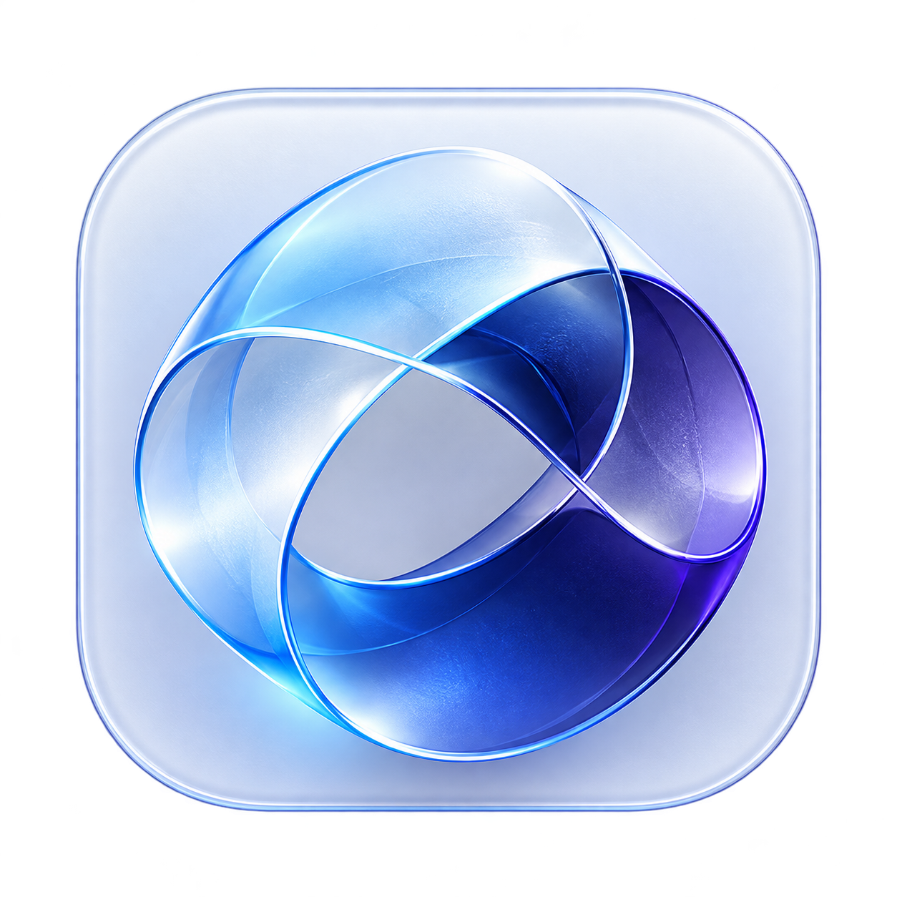
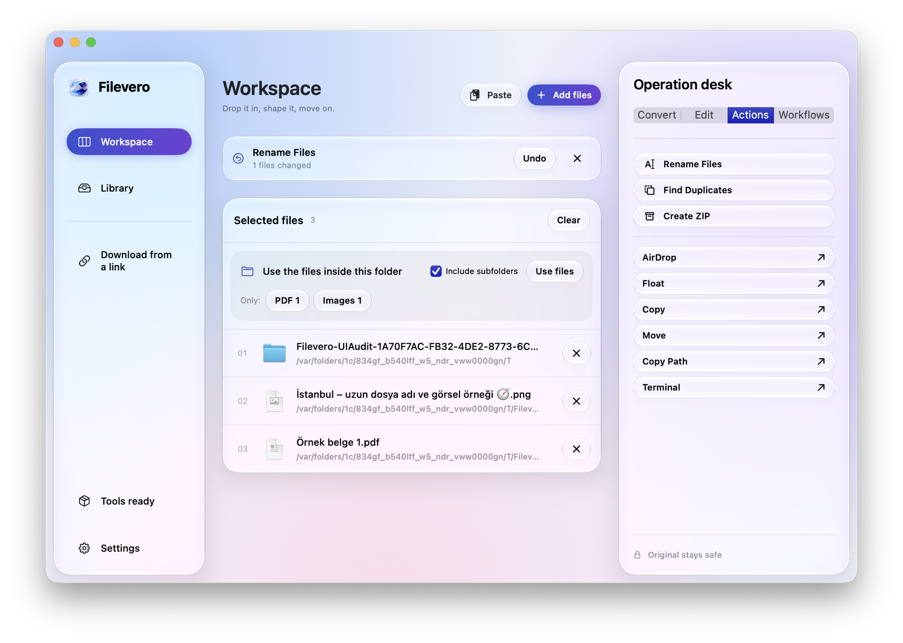
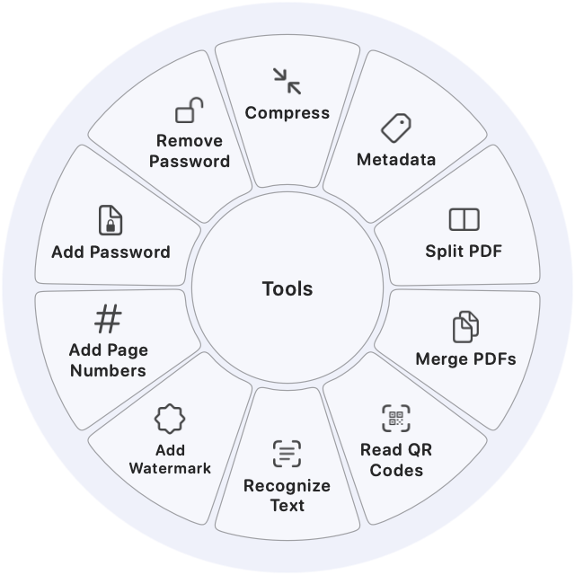
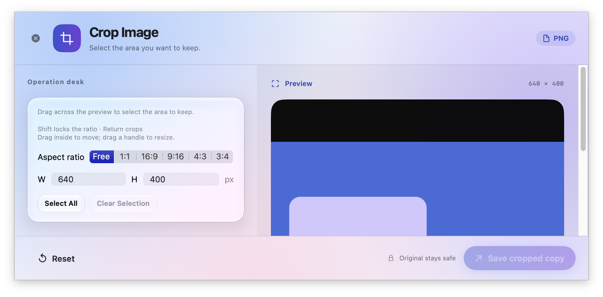
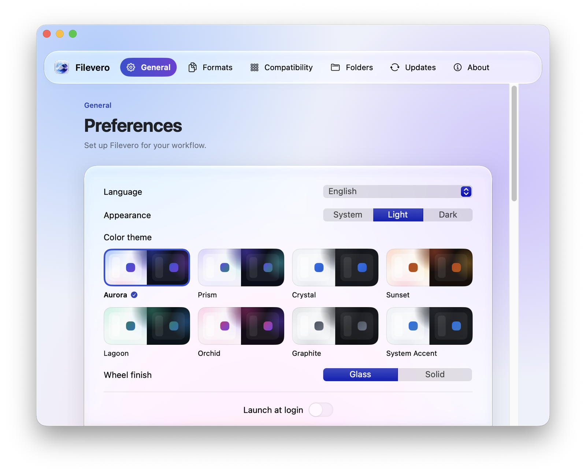
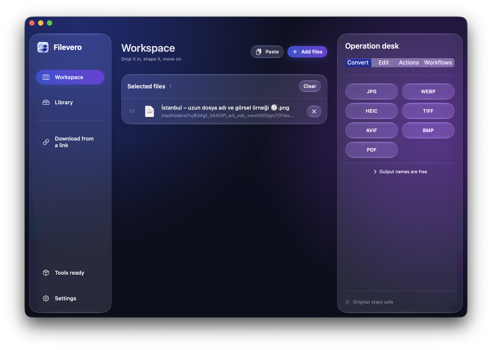

<p align="center"></p>
<h1 align="center">Filevero</h1>
<p align="center"><strong>Every file, in the shape you need.</strong></p>
<p align="center">Convert, edit and organize files on your Mac. Your files never leave it.</p>
<p align="center"><a href="README.tr.md">Türkçe</a> · <a href="https://serdarvaran.github.io/Filevero/">Website</a> · <a href="SECURITY.md">Security</a></p>

<p align="center"></p>

## What Filevero does

Drop a file in, pick what it should become, move on. Filevero brings conversion, editing and file housekeeping into one native app built for macOS's Liquid Glass look.

- **Convert** between 60 input formats along 393 routes: images, camera RAW (DNG, CR2, CR3, NEF, ARW, RW2, ORF), PDFs, Office and Pages documents, EPUB, spreadsheets, slides, audio, video, subtitles and archives (ZIP, 7Z, RAR, TAR, GZ, BZ2, XZ).
- **Edit & Enhance** without leaving the flow: AI background removal (on-device Apple Vision subject lifting), social media & web presets (Instagram, YouTube, X, LinkedIn, Web), crop, annotate, redact, add frames and watermarks, recognize text, trim audio and video, edit metadata.
- **Menu Bar Drop Zone & Shortcuts**: Drag files directly onto the macOS status bar icon to invoke the radial wheel, or automate with Apple Shortcuts and Siri via native AppIntents.
- **Organize** batches: rename with templates, find duplicates, create archives (ZIP, 7Z, TAR, TAR.GZ, TAR.BZ2, TAR.XZ), merge or split PDFs, run saved workflows.
- **Prepare to Share** makes a copy that is safe and light to send: location and other metadata removed, HEIC and RAW photos turned into JPG and large images fitted within 2048 px.
- **Organize PDF pages**: select several pages at once, drag them into a new order, rotate, duplicate or delete them, add pages from other PDFs or images, or save only the selected pages as a new PDF.
- **Watched folders** (Settings → Watched Folders): pick a folder and a saved workflow, and every new file that lands there is processed into the folder’s Filevero subfolder. Workflows run on Windows too.
- **Drag and choose.** Hold **Shift** while dragging in Finder for the conversion wheel, **Command** for tools or **Control** for file actions.
- **Arrange windows.** Drag any window with a modifier to snap it into one of eight layouts.
- **Clipboard history** (off until you turn it on in Settings → Clipboard): press **Control–Command–V** (Windows: **Ctrl+Shift+Alt+V**) to search what you copied, pin favorites, paste as plain text, or send an image or file straight into Filevero. **⌘T** (Windows: **Ctrl+T**) opens actions for the selected item: change text to UPPERCASE, lowercase or Title Case, tidy whitespace, format JSON, copy a text or link as a QR code, or save a copied image as PNG or JPG. Press the shortcut again to close it. Pinned items never count toward the history limit and can't be deleted by accident. History can clear itself when you sign out, shut down or restart.
- **Make it yours.** Eight color themes, light and dark appearance, English and Turkish.

Everything runs locally. Originals stay untouched; every result is saved as a fresh copy.

## A closer look

| Conversion and tools wheel | Crop editor |
| :---: | :---: |
| [](docs/assets/showcase/mac-wheel.png) | [](docs/assets/showcase/mac-crop.png) |
| **Themes and preferences** | **Dark appearance** |
| [](docs/assets/showcase/mac-themes.png) | [](docs/assets/showcase/mac-home-dark.png) |

Screenshots are captures of the running app with generated sample files. [About these images](docs/assets/showcase/README.md).

The [website](https://serdarvaran.github.io/Filevero/#playground) includes a browser playground: drag sample files, try the wheel and shortcuts, and explore all 29 tools.

## Get started

Download Filevero from [Releases](https://github.com/serdarvaran/Filevero/releases/latest):

- **macOS** (Apple Silicon, macOS 13 or later): open `Filevero-macOS-arm64-….dmg` and drag **Filevero** onto the **Applications** folder in its window, then open it from Applications. If you start it from the disk image or Downloads, Filevero offers to move itself there, because Finder services and opening at login need a fixed location. The Mac build is not notarized by Apple yet, so macOS blocks the first launch: open the app once, close the warning, then choose **Open Anyway** for Filevero in **System Settings → Privacy & Security**. Compare the download with its `.sha256` file first. From 1.0.3 on, both apps update themselves: they check these releases, verify the download's Ed25519 signature, install it and restart.
- **Windows** (x64): extract `Filevero-Windows-x64-….zip` into its own folder and run `Filevero.exe`. If SmartScreen asks, choose **More info → Run anyway**.
- **Linux** (x64 or arm64; Ubuntu 22.04+, Debian 13, Fedora 43+): make `Filevero-Linux-x64-….AppImage` (or `-arm64-`) executable and open it. It updates itself after verifying the signature. On GNOME, Settings → Desktop can add the optional Filevero Shell extension for the drag wheels and window arranging everywhere.

To build the Mac app from source on Apple Silicon with macOS 13 or later and Xcode / Swift 6:

```sh
scripts/setup-exiftool.sh
FILEVERO_EXTERNAL_TOOLS=1 scripts/build-app.sh release
```

The app is written to `build/Filevero.app`; `scripts/build-dmg.sh build/Filevero.app Filevero.dmg` packages it as the disk image used for releases. Source builds use an ad-hoc signature unless you provide your own signing profile. To bundle FFmpeg, yt-dlp, Deno and LibreOffice inside the app instead, run `scripts/setup-tools.sh` and `scripts/setup-web-download-tools.py`, then build without `FILEVERO_EXTERNAL_TOOLS=1`.

On first launch, **Finish setup → Download missing tools** installs FFmpeg, yt-dlp and LibreOffice from their upstream sources with pinned SHA-256 hashes. Native image and PDF features work right away. [Versions, hashes and licenses](docs/dependencies.md).

A Windows edition (WPF / .NET 10) shares the same catalog; there, background removal runs the open ISNet model locally. See [Filevero for Windows](windows/README.md). A Linux edition (Avalonia / .NET 10) shares the Windows engines; see [Filevero for Linux](windows/Filevero.Linux/README.md).

## Shortcuts

| Where | Shortcut |
| --- | --- |
| Finder drag | **Shift** conversion · **Command** tools · **Control** file actions (customizable) |
| Anywhere | **Control–Shift–D** downloads a copied public link |
| Anywhere | **Control–Command–V** opens clipboard history (when it is on) |
| Clipboard history | **Return** paste · **Shift–Return** plain text · **⌘1–9** paste a row · **⌘P** pin · **⌘T** actions · **⌘O** open in Filevero · **⌘⌫** delete an unpinned item |
| Workspace | **⌘1** Workspace · **⌘2** Library · **⌘F** find in Library · **⌘O** choose files |
| Media editors | **Space** play/pause · **←/→** seek one second · **I/O** mark a range |
| Crop | Drag to select · **Shift** locks the ratio · **Return** saves |

The [English](https://serdarvaran.github.io/Filevero/#shortcuts) and [Turkish](https://serdarvaran.github.io/Filevero/tr/#shortcuts) pages list every shortcut.

## Privacy

Conversion and editing run on your Mac. Web downloads contact only the site you choose. There is no analytics, cloud account or browser-cookie import. Clipboard history is off by default; when it is on, it stays in a private folder on your computer, and content that password managers mark as concealed or temporary, or that is copied in an app you exclude, is never read or saved. If its index file is damaged, the history is restored from a backup instead of being lost. Watched folders are off until you add one; only files added afterwards are read, and results stay next to them on your computer. Update checks contact only GitHub Releases of this repository, and an update is installed only after its Ed25519 signature matches the key built into the app.

## Development

```sh
swift test
python3 scripts/test-native-ui.py
```

`swift test` runs the engine and updater suites. The UI script renders every screen in both languages, appearances and all eight themes. See [UI audit](docs/testing/UI-AUDIT.md) and [Contributing](CONTRIBUTING.md).

## Support

If Filevero saves you time, you can support its development through GitHub Sponsors or crypto. Support is voluntary and does not change the licence.

[](https://github.com/sponsors/serdarvaran)
[](https://github.com/serdarvaran/serdarvaran#bitcoin)
[](https://github.com/serdarvaran/serdarvaran#ethereum)
[](https://github.com/serdarvaran/serdarvaran#solana)

## License

Filevero is released under the [MIT License](LICENSE). Bundled libraries and external tools keep their own licenses; see the [macOS notices](Resources/THIRD-PARTY-NOTICES.txt) and [Windows notices](windows/THIRD-PARTY-NOTICES.txt).

Filevero is an original, independent application. Its drag-and-wheel radial interaction was inspired by [Tangerine](https://tangerineformac.com/). Filevero is not affiliated with or endorsed by Tangerine or LEAP STUDIO, and contains none of their code or artwork.
