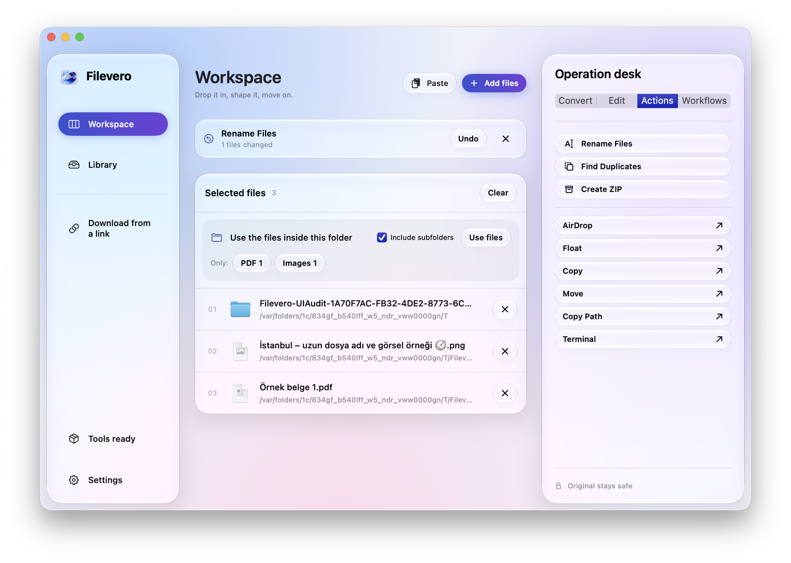
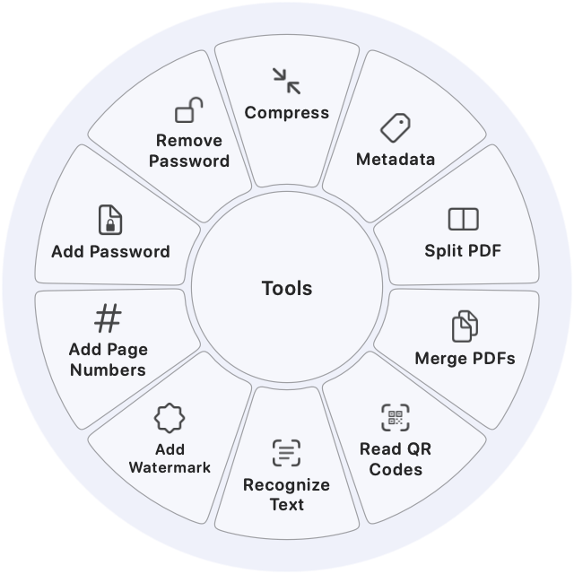
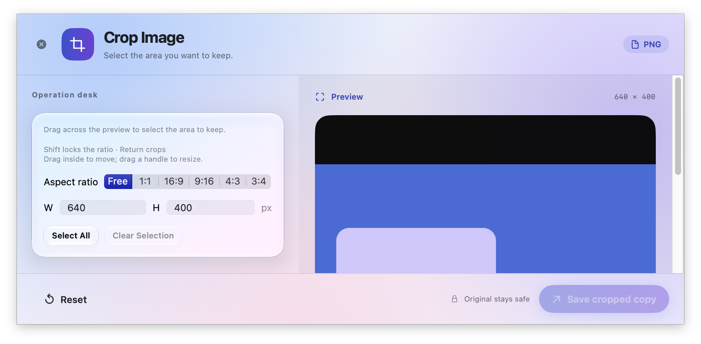
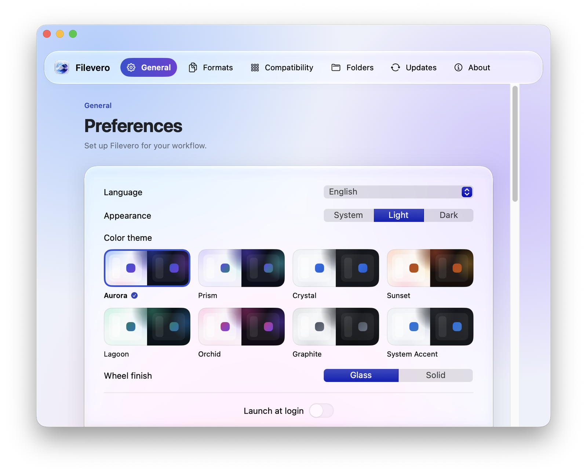
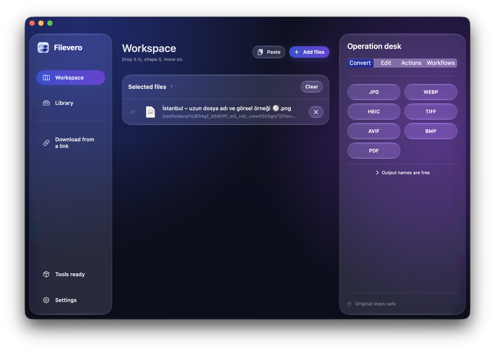

<p align="center"></p>
<h1 align="center">Filevero</h1>
<p align="center"><strong>Her dosya, ihtiyacın olan biçimde.</strong></p>
<p align="center">Mac’inde dönüştür, düzenle ve düzenli tut. Dosyaların cihazından hiç çıkmaz.</p>
<p align="center"><a href="README.md">English</a> · <a href="https://serdarvaran.github.io/Filevero/tr/">Web sitesi</a> · <a href="SECURITY.md">Güvenlik</a></p>

<p align="center"></p>

## Filevero ne yapar?

Dosyayı bırak, neye dönüşeceğini seç, devam et. Filevero dönüştürmeyi, düzenlemeyi ve dosya düzenini macOS’un Liquid Glass görünümüne uygun tek bir yerel uygulamada toplar.

- **Dönüştür:** 60 giriş biçimi arasında 393 yol: görseller, profesyonel kamera RAW formatları (DNG, CR2, CR3, NEF, ARW, RW2, ORF), PDF’ler, Office ve Pages belgeleri, EPUB, tablolar, sunular, ses, video, altyazılar ve arşivler (ZIP, 7Z, RAR, TAR, GZ, BZ2, XZ).
- **Düzenle & Geliştir:** Akıştan çıkmadan yapay zeka ile arka planı kaldır (aygıt içi Apple Vision ile nesne ayıklama), sosyal medya ve web şablonlarıyla kırp (Instagram, YouTube, X, LinkedIn, Web), işaretle, sansürle, çerçeve ve filigran ekle, metin tanı, ses ve videoyu kırp, meta verileri düzenle.
- **Menü çubuğu bırakma alanı ve Kestirmeler:** Dosyaları menü çubuğundaki simgeye sürükleyip bırakarak radyal çarkı aç; Apple Kestirmeler ve Siri (yerel AppIntents) ile dönüştürme ve arka plan kaldırmayı otomatikleştir.
- **Düzenli tut:** Toplu işler için şablonla yeniden adlandır, kopyaları bul, arşiv oluştur (ZIP, 7Z, TAR, TAR.GZ, TAR.BZ2, TAR.XZ), PDF birleştir veya böl, kayıtlı iş akışlarını çalıştır.
- **Sürükle ve seç:** Finder’da sürüklerken **Shift** dönüştürme çarkını, **Command** araçları, **Control** dosya işlemlerini açar.
- **Pencereleri yerleştir:** Bir pencereyi değiştirici tuşla sürükleyerek sekiz yerleşimden birine oturt.
- **Kendine göre ayarla:** Sekiz renk teması, açık ve koyu görünüm, Türkçe ve İngilizce.

Her şey cihazında çalışır. Orijinallere dokunulmaz; her sonuç yeni bir kopya olarak kaydedilir.

## Yakından bakış

| Dönüştürme ve araç çarkı | Kırpma editörü |
| :---: | :---: |
| [](docs/assets/showcase/mac-wheel.png) | [](docs/assets/showcase/mac-crop.png) |
| **Temalar ve tercihler** | **Koyu görünüm** |
| [](docs/assets/showcase/mac-themes.png) | [](docs/assets/showcase/mac-home-dark.png) |

Ekran görüntüleri, üretilmiş örnek dosyalarla çalışan uygulamadan alınmıştır. [Görseller hakkında](docs/assets/showcase/README.md).

[Web sitesinde](https://serdarvaran.github.io/Filevero/tr/#playground) tarayıcıda çalışan bir deneme alanı var: örnek dosyaları sürükle, çarkı ve kısayolları dene, 28 aracın tamamını keşfet.

## Başlarken

**Windows:** Taşınabilir x64 sürümünü [Releases](https://github.com/serdarvaran/Filevero/releases/latest) sayfasından indir, klasöre çıkar ve `Filevero.exe`’yi çalıştır.

**macOS:** Notarize edilmiş indirmeler henüz yayımlanmadı. Filevero’yu Apple Silicon, macOS 13 veya üstü ve Xcode / Swift 6 ile kaynaktan derle:

```sh
scripts/setup-exiftool.sh
FILEVERO_EXTERNAL_TOOLS=1 scripts/build-app.sh release
```

Uygulama `build/Filevero.app` konumuna yazılır. Kendi imza profilini vermezsen kaynak derlemeleri ad-hoc imza kullanır. FFmpeg, yt-dlp, Deno ve LibreOffice’i uygulamanın içine gömmek istersen önce `scripts/setup-tools.sh` ve `scripts/setup-web-download-tools.py` betiklerini çalıştır, sonra `FILEVERO_EXTERNAL_TOOLS=1` olmadan derle.

İlk açılışta **Kurulumu tamamla → Eksik araçları indir**, FFmpeg, yt-dlp ve LibreOffice’i kendi kaynaklarından sabitlenmiş SHA-256 özetleriyle kurar. Yerel görsel ve PDF özellikleri hemen çalışır. [Sürümler, özetler ve lisanslar](docs/dependencies.md).

Windows sürümü (WPF / .NET 10) aynı kataloğu paylaşır; orada arka plan kaldırma açık kaynaklı ISNet modeliyle bilgisayarında çalışır. Bkz. [Windows için Filevero](windows/README.md).

## Kısayollar

| Nerede | Kısayol |
| --- | --- |
| Finder’da sürükleme | **Shift** dönüştürme · **Command** araçlar · **Control** dosya işlemleri (değiştirilebilir) |
| Her yerde | **Control–Shift–D** kopyalanan herkese açık bağlantıyı indirir |
| Çalışma alanı | **⌘1** Çalışma alanı · **⌘2** Kitaplık · **⌘F** Kitaplıkta ara · **⌘O** dosya seç |
| Medya editörleri | **Boşluk** oynat/duraklat · **←/→** bir saniye ileri/geri · **I/O** aralık işaretle |
| Kırpma | Sürükleyerek seç · **Shift** oranı kilitler · **Return** kaydeder |

[Türkçe](https://serdarvaran.github.io/Filevero/tr/#shortcuts) ve [İngilizce](https://serdarvaran.github.io/Filevero/#shortcuts) sayfalar tüm kısayolları listeler.

## Gizlilik

Dönüştürme ve düzenleme Mac’inde çalışır. Web indirmeleri yalnızca seçtiğin siteye bağlanır. Analitik, bulut hesabı veya tarayıcı çerezi aktarımı yoktur. Otomatik güncellemeler, Filevero’nun sürüm kanalı ve imza anahtarı yapılandırılana kadar kapalıdır.

## Geliştirme

```sh
swift test
python3 scripts/test-native-ui.py
```

`swift test` motor ve güncelleyici testlerini çalıştırır. UI betiği her ekranı iki dilde, iki görünümde ve sekiz temanın tamamında çizer. Bkz. [UI denetimi](docs/testing/UI-AUDIT.md) ve [Katkı rehberi](CONTRIBUTING.md).

## Lisans

Filevero [MIT Lisansı](LICENSE) ile yayımlanır. Birlikte gelen kütüphaneler ve harici araçlar kendi lisanslarını korur; bkz. [macOS bildirimleri](Resources/THIRD-PARTY-NOTICES.txt) ve [Windows bildirimleri](windows/THIRD-PARTY-NOTICES.txt).

Filevero tamamen özgün ve bağımsız bir uygulamadır; sürükle ve çark etkileşimi [Tangerine](https://tangerineformac.com/) adlı uygulamadan ilham alınarak geliştirilmiştir. Filevero’nun Tangerine veya LEAP STUDIO ile herhangi bir bağlantısı yoktur ve onların kod ya da tasarım ögelerini içermez.
